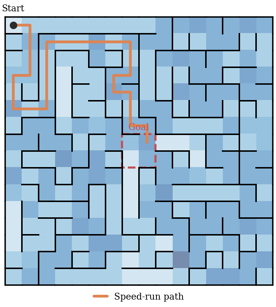
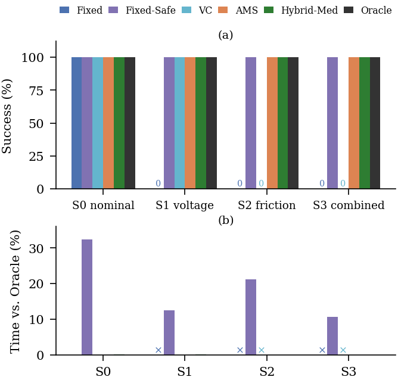

# AMS Micromouse

[](https://github.com/vidit-16/AMS-Micromouse/actions/workflows/build.yml)
[](LICENSE)

A drift-aware cost-model simulator for micromouse robots.

A micromouse plans its speed run with a table of how long each motion primitive takes (one cell forward, 90° pivot, 180° pivot). On a real robot those times drift: the battery sags, the floor and tyres change, and the motors heat up. If the robot commands times that are too short, it loses track and crashes. If it adds a big safety margin, it is slow.

This project simulates that problem and compares ways of handling it. The main one is **AMS (Adaptive Model Switching)**: it learns per-primitive slowdowns from the robot's own exploration run, and switches to the learned cost model only when the drift is significant.

<p align="center">
  
  
</p>

## Results at a glance

Success rate over 1,000 trials per cell (100 mazes × 10 reps), experiment E1:

| Scenario | Fixed | Fixed-Safe | VC | AMS | Hybrid-Med | Oracle |
|---|---|---|---|---|---|---|
| S0 nominal | 99.9 % | 100 % | 99.9 % | 99.9 % | 99.9 % | 99.9 % |
| S1 voltage sag | 0 % | 100 % | 99.9 % | 99.9 % | 99.9 % | 99.9 % |
| S2 friction / heating | 0 % | 100 % | 0 % | 99.9 % | 99.9 % | 99.9 % |
| S3 combined | 0 % | 100 % | 0 % | 99.9 % | 99.9 % | 99.9 % |

- **Fixed** fails as soon as the robot is slower than its 2 % margin.
- **Fixed-Safe** (35 % margin) always finishes, but is 10.6–32.3 % slower than the Oracle.
- **VC** (voltage compensation) only fixes slowdowns that affect every primitive equally.
- **AMS** and **Hybrid-Med** learn the per-primitive slowdown during exploration and finish within 0.05 % of Oracle time.

More figures are in [docs/figures](docs/figures).

## Features

- **Braided 16 × 16 mazes** with loops and an open 2 × 2 goal, so the time-optimal planner has real route choices.
- **Turn-aware time-optimal planner**: Dijkstra over `(x, y, heading)` with separate costs for F, R, L and U.
- **Non-uniform degradation**: a voltage factor that affects every primitive, times per-primitive residuals (friction, heating) that a voltage sensor cannot see, plus optional battery discharge during the run.
- **Realistic timings**: speed run 100 / 180 / 300 ms (forward / turn / U-turn, 1.8 m/s on 180 mm cells); exploration 300 / 360 / 540 ms.
- **8 strategies**: Fixed, Fixed-Safe, VC, AMS, AMS-Med, Hybrid, Hybrid-Med and Oracle. See [docs/strategies.md](docs/strategies.md).
- **Reproducible**: strategies share random numbers, and every result comes from one script.

## Repository layout

```
.
├── src/micromouse_sim.cpp          C++17 simulator (maze generation, exploration, planning, speed run)
├── scripts/
│   ├── sim_runner.py               runs the simulator for one parameter set, returns a DataFrame
│   ├── run_experiments.py          experiments E1–E9
│   ├── run_sensor_experiments.py   experiments E10 and E6b (voltage sensor, transfer factor)
│   └── make_figures.py             all figures (PDF + PNG) into figs/
├── results/
│   ├── all_runs.csv.gz             every trial of every experiment (772,000 rows)
│   └── trace_maze0.txt             exploration / speed-run trace for the maze figure
├── docs/                           parameters, experiments, strategies, figures, changelog
├── Makefile
└── requirements.txt
```

## Quick start

You need a C++17 compiler (GCC or Clang; the code uses `<bits/stdc++.h>`), Python 3.9+ and `make`. On Windows, use WSL or MinGW-w64.

```bash
git clone https://github.com/vidit-16/AMS-Micromouse.git
cd AMS-Micromouse
pip install -r requirements.txt
make                      # builds build/micromouse_sim
```

Run one configuration (8 strategies × 100 mazes × reps):

```bash
./build/micromouse_sim b0=0.85 rhoP=0.15 reps=10 > out.csv
```

Arguments are `key=value`. All keys are listed in [docs/parameters.md](docs/parameters.md).

## Reproducing the results

```bash
make experiments          # E1–E9   -> results/all_runs.csv.gz
make sensor-experiments   # E10, E6b (added to the same file)
make trace                # results/trace_maze0.txt
make figures              # figs/*.pdf, figs/*.png
```

The repository already contains the full results, so `make figures` works straight after cloning, without building the simulator.

> **Note:** results are bit-identical only with the same compiler and C++ standard library, because `std::normal_distribution` and `std::shuffle` are implementation-defined. The included results were produced with GCC / libstdc++ on Linux.

Experiment definitions are in [docs/experiments.md](docs/experiments.md).

## License

[MIT](LICENSE) © 2026 Vidit Choudhary, Saransh Baid, Sakshi Bhongle
